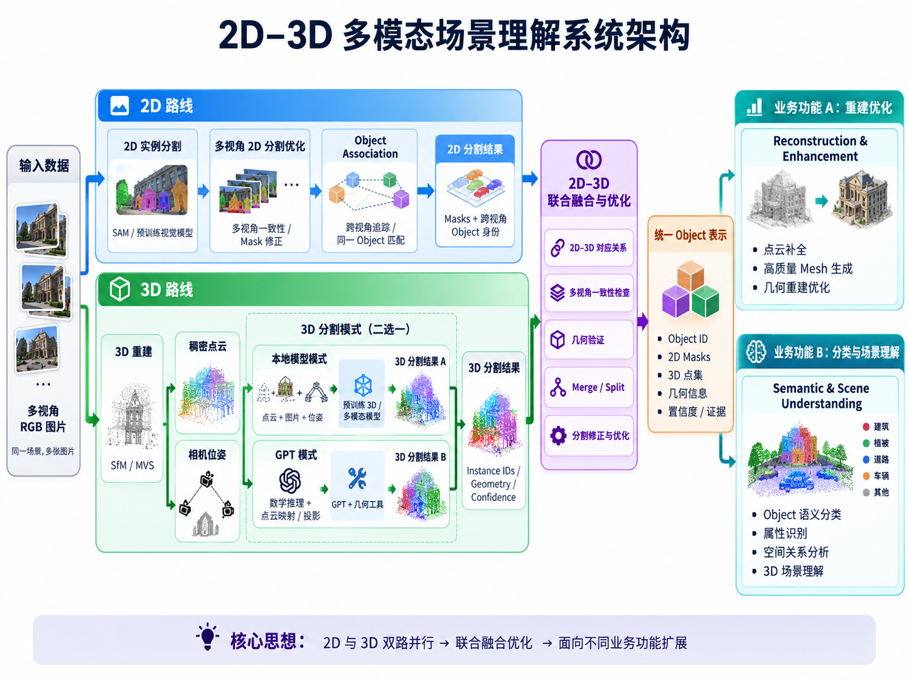

# 2D–3D 多模态场景理解系统

**Multimodal 3D Scene Understanding**

一个面向三维对象发现、实例分割与场景理解的模块化研究项目。使用**多视角 RGB 图片 + 三维重建 + 预训练模型 + 几何算法**，在**不自行训练大模型**的前提下，融合 2D 和 3D 分割结果，形成统一的 3D Object。

> **当前状态：架构构想 / 待实现原型。** 本文描述计划中的系统，不代表相关功能已经全部实现。

## 核心思路

### 2D 路线

对图片进行实例分割，利用**多视角一致性、Object Association 与追踪**修正 Mask 错误，找到不同照片中的同一物体。并非一定要对全部 128 张图片逐张执行完整模型推理，可根据覆盖范围和可见性选择视角。

### 3D 路线

通过 **SfM / MVS** 获得稠密点云及相机位姿，然后在以下两种分割模式中选择一种：

- **Local Model**：使用现成预训练 3D 或 2D+3D 模型，按具体模型支持的输入形式处理点云、图片和相机信息
- **GPT + Geometry Tools**：本地计算几何特征、Candidate 和点云多视角投影；GPT 提供分析/操作建议，由本地程序完成精确逐点处理

**GPT 是可选模式，不是系统的必要依赖。** 两种模式采用同一种 3D 分割结果格式。

### 融合与优化（核心）

通过相机位姿建立 **3D Point ↔ 2D Pixel/Mask** 对应关系，再综合跨视角一致性与几何连续性，处理错误合并、过度拆分、遮挡和对象身份冲突。2D 与 3D **互相修正**，其中任何一方都不被视为绝对正确。

最终输出一个统一 Object，包含 `Object ID`、对应的 `2D Masks`、`3D Point IDs`、几何信息、证据以及不确定性标记。

## 两类下游应用

| 重建增强 | 分类与场景理解 |
|---|---|
| 点云质量提升与补全 | 物体语义分类 |
| 表面重建、高质量 Mesh | 属性与空间关系分析 |
| 对象级几何优化 | Scene Graph、场景问答 |

它们可以独立开发，并共用同一套 Object 数据。**真实观测几何与 AI 推测补全几何必须区分保存。**

## 已有基础与当前缺口

- 以前曾以 **128 张图片**通过 pycolmap + SIFT 完成 SfM 和相机位姿恢复
- 曾开展 E57 点云预处理、几何分析与实例分割实验
- **尚需验证**：MVS 稠密重建质量、多视角 Mask 优化、2D–3D 对应、融合算法及完整端到端流程

## 建议的实现顺序

1. 完成稠密重建与点云—图片重投影验证
2. 建立 2D 多视角 Mask 与跨视角 Object Association
3. 接入至少一种 3D 分割 Backend（Local 或 GPT）
4. 实现 Correspondence + Fusion + Merge/Split 的最小闭环
5. 保存统一 Object，加入人工检查，再扩展业务模块

## 设计约束

- 不以重新训练模型为前提；优先使用预训练权重和成熟几何工具
- 不要求每个模型都同时支持点云、图片和相机位姿
- 不强制每个点归属某个 Object；允许 Unknown 与人工审核
- 不把生成式几何补全误认为真实测量
- 考虑单人开发的计算资源与维护成本，尽量模块化和可替换

**详细架构、数据结构、融合算法、工程接口、风险与路线图请见 [`Multimodal_3D_System_Design.md`](./Multimodal_3D_System_Design.md)。**
