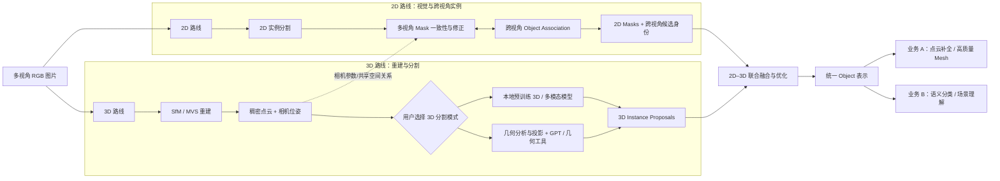
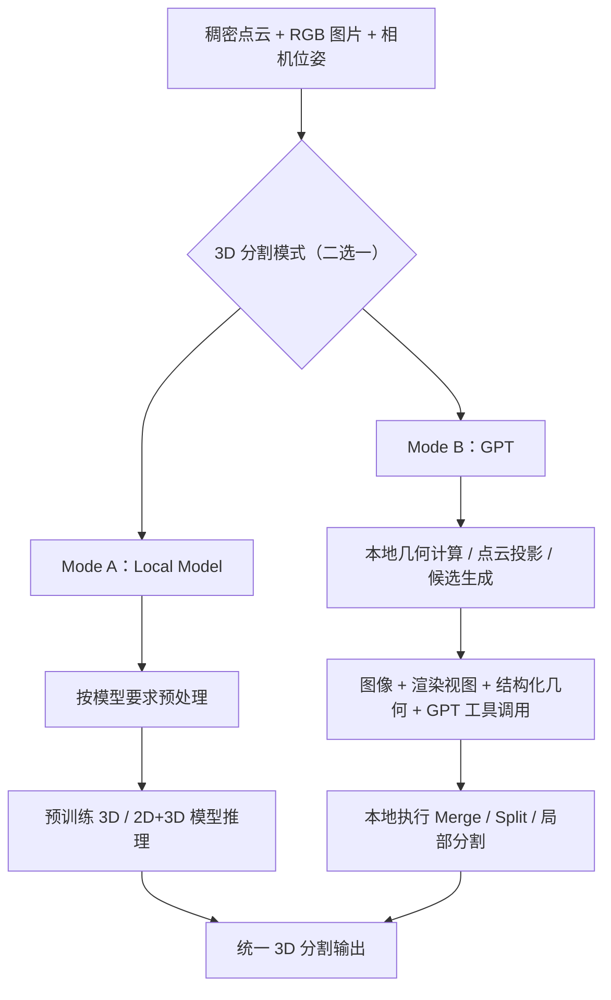
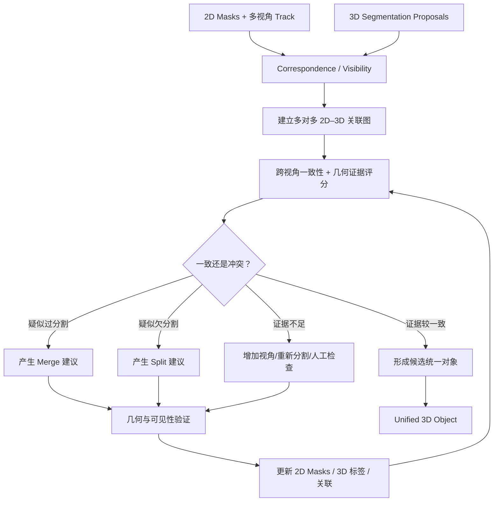

# Geometry-Guided Multimodal 3D Scene Understanding System

> **2D–3D 多模态场景理解系统：完整构想与技术设计总结**  
> 版本：Concept v0.1｜日期：2026-10-08｜阶段：方案设计，尚非已实现系统  
> 定位：个人研究与可扩展工程原型；不以 BIM/IFC 交付为前提

## 0. 文档说明

本文总结我们围绕 Reality2BIM 延伸出的新项目构想。重点是**系统目标、两条并行路线、两种 3D 分割模式、2D–3D 融合、数据组织、下游业务能力和实施边界**。本文是设计蓝图，而非实验成功报告；提出的算法、接口、阈值、模块和目录均属于**建议方案**，后续应通过小规模实验验证。

### 0.1 一句话目标

输入同一场景的多视角 RGB 图片（未来可选外部 LiDAR 点云），通过**2D 多视角视觉分割**和**3D 重建与分割**两条并行路线，建立 2D–3D 对应关系，联合优化得到跨视角一致的三维 Object 实例；再将统一对象表示交给**几何重建增强**或**语义与场景理解**等下游功能。

### 0.2 核心设计原则

1. **双路并行**：2D 与 3D 各自给出候选及分割证据，允许独立犯错，也允许互相纠正
2. **3D 二选一模式**：预训练本地 3D/多模态模型，或 GPT + 本地几何工具；不强制同时运行
3. **不训练大模型**：优先现成权重、成熟工具与算法；不假设有大规模自标注数据
4. **GPT 非必要依赖**：GPT 模式是可选引擎，不是整个系统的必经路径
5. **数据可追溯**：原始点、相机、2D Mask、3D 提案、融合结果应保留来源和置信依据
6. **允许不确定**：面对遮挡、重建缺失和矛盾证据，允许 Unknown 与人工复核，不强制所有点归类
7. **分割与业务解耦**：统一 Object 表示是核心交付；Mesh 补全和语义理解属于独立业务模块
8. **观测与生成分开**：真实测量/重建的几何和 AI 推测补全的几何必须区分存储

---

## 1. 为什么从 Reality2BIM 演变成现在的系统

早期 Reality2BIM 更强调「现实扫描数据 → 实例分割 → 分类 → IFC」。在点云处理中遇到的问题包括：

- LiDAR 或摄影测量点云虽然点数多，但仍因遮挡、视角和低纹理产生缺失
- 几何相似物体在工业场景中很难仅凭 3D 形状区分
- 传统聚类可能把一个完整设备切成多块，或把邻近设备合成一块
- 纯 3D 模型的权重、环境和显存要求增加个人开发负担
- AI 对几何的语义判断可以很强，但直接输出精确逐点实例标签并不总是其原生能力

因此，将研究目标改为：**先得到可靠的跨视角三维对象，再按需求扩展补全、Mesh、语义、空间关系，而不是从一开始就绑定 IFC。**

### 1.1 已有实验基础（不是对新系统的完成声明）

- 曾使用约 **128 张、3024×4032 的图片**，以 **pycolmap 4.2.1 + SIFT CPU** 完成 SfM；历史记录为 128 张注册成功、约 46,809 个稀疏点、1 个稀疏模型
- 当时曾尝试 ALIKED，因 ONNX 相关问题改用 SIFT；已生成过相机位姿与 sparse model
- E57 点云实验曾进行噪声过滤、几何分析、对象实例划分、分类和简单 IFC 尝试
- 已讨论/尝试 Open3D、RANSAC、聚类、点云投影、WarpConvNet/SpaCeFormer、Pointcept 等路线，但**不代表每一个模型都已运行成功**
- MVS 稠密重建、统一图像–点云坐标、2D/3D 联合融合、完整多视角 2D Mask 优化等仍属于待验证/待开发阶段

---

## 2. 总体逻辑架构

### 2.1 主流程



**重要说明：** 图中的两个分支是**功能逻辑并行**，不是彼此完全隔离。相机位姿由 3D 重建计算，可以作为 2D 跨视角关联/一致性的几何依据；融合阶段也允许把错误反馈给前面的 2D/3D 模块重算。

### 2.2 分层职责

| 层 | 职责 | 典型产物 |
|---|---|---|
| 输入与数据管理 | 管理原图、相机、点云、坐标系与版本 | Images、Camera Set、Point Cloud |
| 2D Pipeline | 发现像素级对象、跨视角匹配和 Mask 修正 | Masks、Image-local IDs、Cross-view Tracks |
| 3D Pipeline | 重建点云、产生三维实例候选和几何证据 | Point IDs、3D Proposals、Geometry Features |
| Correspondence | 建立点–像素、Mask–点集、2D–3D Candidate 关系 | Visibility、Projection、Associations |
| Joint Fusion | 对冲突进行检查、合并/拆分及双向修正 | Unified Instances、Evidence、Confidence |
| Unified Object | 为后续模块提供稳定对象接口 | Object IDs、Masks、Points、Metadata |
| Business Modules | 补全、Mesh、分类、关系推理 | Enhanced Geometry、Semantic Scene |

---

## 3. 输入、坐标系与重建基础

### 3.1 主输入

首个实验场景优先使用：

- 同一场景、具有足够重叠的 **128 张 RGB 图片**（并非强制使用全部图片进行 2D 模型推理）
- 从 SfM 估计的每张图片的相机**内参 K**和**外参 R,t**
- MVS 生成的稠密点云（XYZ、可选 RGB、置信/质量、Point ID）

可选输入：已有 **E57 / PLY LiDAR 点云**、用户已有分割结果、已知尺度、控制点与人工标注。

### 3.2 3D Reconstruction 属于 3D 路线

推荐先利用已有 SfM 成果，再进行 MVS：

1. 图像验证、去重、必要的畸变处理
2. Feature Extraction & Matching：例如历史验证过的 SIFT / COLMAP
3. SfM：估计相机位姿，生成稀疏点云，完成 bundle adjustment
4. MVS：深度图推理/计算与多视角深度融合，生成稠密点云
5. 点云质量检查：覆盖、噪声、畸变、配准误差、可见性
6. 为所有图像与点云保留一致的相机参数和坐标变换

**Matching 与 MVS 各自承担不同职责**：更强匹配可能改善位姿及稀疏重建，但不保证直接提升稠密点云质量；深度估计、图像覆盖、视角分布与融合策略需要另行优化。

**尺度提醒**：普通单目 SfM 通常有全局尺度不确定性。若结果要输出真实长度/尺寸，需有已知尺度、控制点、深度测量或其他尺度来源。

**LiDAR 提醒**：外部 E57 与摄影测量结果未必同坐标，需要刚体/相似变换配准，并验证配准残差；不能直接假设图片位姿与 LiDAR 天然一致。

---

## 4. 2D Pipeline：多视角视觉实例分割

### 4.1 功能定位

2D 路线直接从原始图像观察物体，输出像素级 Mask 与不同视角间的 Object Association。它不需要等待 3D 完成逐点分割；但可以利用 SfM 位姿、粗深度或三维对应点提高关联与一致性。

### 4.2 建议处理流程

1. **视角管理**：以全部图片建立相机索引，选择一组覆盖全场景的代表视角
2. **2D Instance Segmentation**：采用已有权重的 2D 分割模型获得初始 Masks
3. **Multi-View Association**：关联不同视角中的同一实体，建立临时跨视角 Track ID
4. **Multi-View Consistency**：比较对应 Mask 的重投影、外观及可见性证据
5. **Mask Refinement**：在冲突区域选取额外视角、重新提示/分割、过滤不可靠 Mask
6. **输出**：每张图片的 Masks + 关联到同一对象的 Track + 质量分数/冲突记录

### 4.3 两种多视角优化路线

- **联合模型路线**：使用支持多视角联合推理的预训练模型，直接估计多个视角的一致 Mask；应核实实际输入格式、权重、显存与适用视角数量
- **模块组合路线**：单视角 SAM 类模型 + 跨视角追踪/视觉特征 + 相机几何一致性 + 局部重新分割；无需自行训练大模型，易于调试

可研究的已讨论方向包括 SAM 2 系列、多视角 Mask 关联、Any3DIS、SAM2Object、Open3DIS 以及面向联合几何和 Mask 的新工作。这些名称只是研究线索，**不能默认它们都直接支持相同输入、具有可用权重或能在 12GB 显存内完整运行**。

### 4.4 128 张图片是不是每张都要运行分割？

不必。建议两级 **Adaptive View Selection**：

- **Global View Selection**：挑选覆盖全场景的图像，发现 3D 路线可能遗漏的物体
- **Local View Selection**：围绕某个候选物体，选择清晰、互补、无遮挡的视角进行关联和修正

全部注册图片都可参与相机/可见性分析；仅对被选中的图片进行高开销的视觉推理。缓存 Mask、视觉特征、投影结果；新视角仅在证据不足时加入。视角选择要关注覆盖率、基线差异、成像质量和遮挡，而非单纯数量。

### 4.5 2D 路线的输出不等于真实 3D 对象

- 单张图的 Mask ID 只在该张图片中有意义
- Track ID 代表“可能是同一真实物体”的跨视角关联假设
- 遮挡、反射、外观相似和大视角变化都可能导致错误
- 最终 Object ID 必须经过 2D–3D Joint Fusion 才确定

---

## 5. 3D Pipeline：重建 + 可切换的分割引擎

### 5.1 一条 3D 路线，两种运行模式

重建得到点云和相机参数后，用户**选择其中一种** 3D 分割模式：



### 5.2 Mode A：Local Model

**理想输入**：点云 + 对齐图片 + 相机位姿。实际可行性必须以选用的具体预训练模型为准：

- 有些模型仅接受点云 XYZ/RGB
- 有些模型接受 2D 图像、相机、点云或它们的投影关系
- 有些模型需要 Superpoints、已有 2D Mask、预训练 backbone 或特定数据集格式
- 模型是否无需训练即可用于当前工业场景，取决于可用 checkpoint、训练域和泛化能力

典型输出应规范成 `Point ID → predicted Instance ID`，并尽量保存模型原始分数与输入依赖。硬件目标可以优先考虑现有 RTX 3060 12GB，但不要假设所有模型都能直接在该显卡运行。

### 5.3 Mode B：GPT + Geometry Tools

先利用本地 Python/3D 工具处理真实点云，再由 GPT 判断候选和调用工具。建议流程：

1. 本地提取 Geometry Features（例如距离、尺寸、PCA 主轴、法向量、曲率、平面、Superpoints、邻接）
2. 本地渲染多视角点云、局部深度、法向量或彩色投影，并关联原始 RGB
3. 生成候选区域与结构化描述，记录点索引、视角、投影变换和质量
4. 将**图片、投影、几何摘要、候选与工具接口**交给 GPT 推理
5. GPT 提出检查/合并/拆分/重新渲染等操作建议；本地几何代码执行精确逐点操作
6. 记录每步证据，必要时复查；对模棱两可的情形标为 Unknown/Review

**关键限制**：通用 GPT 视觉 API 不能直接视为“接收任意原始 E57/PLY 并原生输出可靠逐点实例标签”的 3D 分割网络。可以在支持代码/工具调用的工作流中操作文件，但实际几何处理仍依赖程序。此模式通常比本地神经网络更偏**工具驱动的推理与决策**，不应假装两者计算机制相同。

### 5.4 二选一 ≠ 两个结果必须一起融合

本地模式和 GPT 模式在**接口格式上统一**，运行时一般只选一个作为 3D 分割结果来源。日后可以为了比较或消融实验同时运行两者，但不应作为正常流程的硬性要求。

### 5.5 3D 侧可共享的几何工具

- 数据读写与点 ID 保留；滤波、下采样与去噪
- 法向量/曲率、PCA、主方向、OBB/AABB、体素与近邻搜索
- RANSAC 平面/规则几何检测；连通组件、DBSCAN/Superpoints
- 多视角点云投影、深度缓冲、可见性和遮挡检测
- Candidate Merge/Split、邻接图构建与局部重计算

这些工具主要供 GPT 模式与 Joint Fusion 使用，也可供本地模型完成数据预处理或事后验证。**不强制把几何分割结果喂给本地模型**，避免不必要的输入依赖和错误传播。

---

## 6. 2D–3D Correspondence：把两种结果放在同一空间比较

这是 Joint Fusion 前必须建立的公共接口。

### 6.1 Point → Pixel 投影

对世界坐标中的点 \(\mathbf{X}_w\)，通过相机外参变到相机坐标 \(\mathbf{X}_c=R\mathbf{X}_w+t\)，再应用相机内参 \(K\)：

\[
 s\begin{bmatrix}u\\v\\1\end{bmatrix}=K\begin{bmatrix}R&t\end{bmatrix}\begin{bmatrix}X\\Y\\Z\\1\end{bmatrix}
\]

注意使用与 COLMAP/导出文件一致的外参约定；必要时先进行图像去畸变或在投影中显式考虑畸变模型。

对每个图像，系统需计算或缓存：

- 哪些点落在像素边界内、相机前方
- 哪些点真正可见，哪些被前景表面遮挡（z-buffer / 深度一致性）
- 每个可见 3D Point ID 对应像素 \((u,v)\) 和深度
- 该像素落入哪些有效 Mask（考虑 Mask 质量、边界误差）

**不能只看投影是否落在 Mask 内而忽略深度/遮挡**，否则隐藏在后面的点会被错误归属。

### 6.2 关联而不是直接强制一一匹配

两条路线产生的 Candidate 通常不是相同粒度：

- 一个完整的 2D Mask 可能覆盖多个被遮挡切开的 3D Clusters
- 一个过度合并的 3D Cluster 可能对应多个 2D Masks
- 部分 Candidate 可能在另一模态里没有对应实例

应维护**多对多关联图**：`Mask ID ↔ Point IDs ↔ 3D Proposal IDs`，而不是直接把 Mask A = Cluster 8 作为事实。

### 6.3 关联分数（建议设计）

依据可见点对应关系，可为 `Mask m ↔ 3D Proposal c` 建立分数：

- **Visible coverage**：Proposal 的可见点中有多少投影到 Mask 内
- **Mask support / purity**：Mask 下的有效三维点中有多少来自 Proposal
- **Reprojection consistency**：不同视角得到的证据是否一致
- **Appearance similarity**：图像特征在不同视角中是否相似
- **Geometry consistency**：表面/轴线/空间邻接是否支持同一实体
- **Quality**：像素面积、遮挡率、视角角度、相机位姿不确定性

这些指标可形成候选匹配排名，但不能把某个手工公式直接当作已经校准的真实概率。

---

## 7. Joint 2D–3D Fusion & Optimization（系统核心）

### 7.1 融合要解决的不是单纯投票

2D 和 3D 都可能有错误，因此 **2D Mask 不作为绝对 Ground Truth**，3D 模型输出也不作为绝对 Ground Truth。Fusion 的职责是利用彼此互补的证据，修正过度分割、欠分割、遮挡错误和跨视角身份冲突。

### 7.2 建议的处理逻辑



**一次迭代示例：**

1. 3D 分割将同一根管道切为 Cluster 1、2、3
2. 多个有效视角中的 Mask 关联显示它们可能属于同一 Object Track
3. Fusion 检查三个 Cluster 的可见重投影、主轴连续性、端点距离、局部连接关系
4. 若证据足够，执行合并并重新检验；若不同视角持续冲突，则保留拆分或待审核
5. 将修正后的 3D Point IDs 映射回相关图片，检测需要重新细化的 2D Mask

反向也成立：单张 2D Mask 错把管道和支架合在一起，3D 几何与其他视角支持拆分时，可生成新的局部提示，重新运行 2D 分割。

### 7.3 建议从规则/图优化开始，不急于训练融合网络

- **第一阶段**：基于可见性、关联图、几何验证、明确规则的 Merge/Split
- **第二阶段**：引入 Superpoint 邻接图、图分割/能量优化或概率融合，以兼顾全局一致性
- **第三阶段**：按需加入可选的视觉语言推理，解释难例，而非让 GPT 决定所有点

不要把关联分数、模型原始 confidence 与数学几何一致性分数直接相加当成准确概率；需要归一化、校准或有监督的少量评估来设置规则。

### 7.4 依赖证据不能重复计票

若某个 3D 多模态模型已将 2D SAM Mask 当输入，那么最终融合时这套 3D 输出和原始 2D Mask **不是独立证据**。应记录每项 Proposal 所依赖的数据和模型，以免同一错误在两条路线里被重复强化。

### 7.5 最终结果允许三种状态

- **Accepted**：多视角与几何证据比较一致
- **Uncertain**：存在冲突、观察覆盖不足或算法分歧
- **Needs Review**：自动融合不足以形成可信结果，等待人工 Merge/Split/Delete

不建议硬性要求“每个点必须归属一个对象”。噪声、背景和不可解释区域可以保留 Unknown/Unassigned。

---

## 8. Unified Object Representation：核心系统对外的统一对象接口

### 8.1 识别四类 ID

1. **Point ID**：原始/工作点集里的稳定索引；与下采样映射保持关系
2. **Image Mask ID**：每张图像的局部 Mask 编号
3. **Track ID**：跨视角匹配时的候选身份，可在融合中合并/拆分
4. **Object ID**：Fusion 最终输出的全局实例身份

这四种 ID 不应该混用；特别是 Mask ID 与 Object ID 不是一回事。

### 8.2 建议输出字段

- `object_id`、`point_ids`、`masks_by_image`、`source_proposals`
- `bbox_aabb` / `bbox_obb`、尺寸、位置、主轴、表面特征、邻近对象
- `association_evidence`、`view_support`、`quality_flags`、`status`
- `semantic_class`（可为空）、`semantic_confidence`（可为空）
- `geometry_observed` 和 `geometry_inferred` 分开保存
- `coordinate_system`、`scale_status`、`provenance`、`version`

### 8.3 对象数据结构（示意，不是已实现 API）

```json
{
  "object_id": "obj_0017",
  "status": "uncertain",
  "point_ids": [1003, 1004, 1008],
  "masks_by_image": [
    {"image_id": "img_012", "mask_id": "mask_05", "track_id": "track_09"},
    {"image_id": "img_037", "mask_id": "mask_02", "track_id": "track_09"}
  ],
  "geometry": {
    "bbox_dimensions": [0.8, 0.3, 0.25],
    "unit": "unknown_until_scale_calibration"
  },
  "semantic_class": null,
  "evidence": {
    "visible_views": 2,
    "source": ["2d_masks", "3d_model", "geometry_validation"]
  },
  "geometry_observed": "point_ids",
  "geometry_inferred": null
}
```

**关于导出**：可先使用 JSON 保存对象级索引/关系，配合 PLY/LAZ 等高效点云格式保存真实几何；不要默认将几百万个 XYZ 点全部嵌入一个巨大 JSON。已有 PointLab 风格的数据可通过独立适配器导入/导出。

---

## 9. 两条下游业务路线

### 9.1 业务 A：Reconstruction & Enhancement

**目的**：利用统一 Object 边界和多视角图像，对每个对象进行几何增强与可编辑表示生成。

可逐步扩展：

1. 对象点云质量检查与局部去噪
2. 结合可见图像补充实际观测到、但初始点云遗漏的表面
3. Surface Reconstruction：从已有点云估计连续表面/三角网格
4. Point Cloud Completion：预测被遮挡的部分（推测性）
5. Object-level Mesh Reconstruction：高质量 Mesh、纹理、拓扑与细节优化
6. 可选输出 BIM/IFC/CAD 语义几何（后续业务，而非系统核心前提）

重点区分：**摄影测量稠密重建 ≠ 表面重建 ≠ 生成式补全**。缺失部分的合理生成，不等于恢复真实测量数据。若要工业测量精度，还需要真实尺度和独立精度验证。

### 9.2 业务 B：Semantic & Scene Understanding

**目的**：从对象及其多视角证据中理解类别、属性、功能和对象关系。

可逐步扩展：

1. Object Semantic Classification：语义类别、未知类别、细粒度标签
2. Object Attributes：材质、状态、标识、可辨识功能
3. Spatial Relations：上下、相邻、接触、穿越、包含、距离、方向
4. Scene Graph：对象作为节点，空间/功能关系作为边
5. 3D Visual Grounding / Scene QA：通过自然语言定位对象、回答场景问题

VLM / GPT 在此路线可作为可选增强；本地视觉编码器和几何计算亦可承担一部分。语义标签不能覆盖真实测量/几何证据。

### 9.3 两条业务路线可以互相帮助但不应绑死

例如语义分类推断对象可能是一根管道，补全模块可以**在标注为假设**的前提下使用圆柱先验；几何增强得到更清晰的形态，也可能提升分类。然而两个业务模块应能独立开启、独立保存结果。

---

## 10. 工程模块与接口建议

这里是**建议的软件划分**，而不是现有仓库结构。

| 模块 | 接口职责 | 是否属于核心 |
|---|---|---|
| `data_io` | 读取 RGB、COLMAP、PLY/E57，统一坐标与 ID | 是 |
| `reconstruction` | SfM/MVS 任务与输出检查 | 是（3D 路线） |
| `camera_geometry` | 投影、反投影、可见性、尺度/坐标变换 | 是（共享） |
| `segmentation_2d` | 分割、Mask 缓存与视角选择 | 是 |
| `multi_view` | 2D Track、跨视角一致性、Mask refinement | 是 |
| `segmentation_3d` | `LocalModelBackend` / `GPTGeometryBackend` | 是 |
| `geometry` | 局部特征、聚类、法向量、合并/拆分与验证 | 是（共享） |
| `correspondence` | Mask–Point–Proposal 多对多匹配 | 是 |
| `fusion` | 证据评分、冲突检测、迭代优化 | 是 |
| `object_store` | Unified Object schema、溯源、版本与导出 | 是 |
| `reconstruction_enhancement` | 补全、Mesh、纹理 | 否，下游 |
| `semantic_scene` | 分类、Scene Graph、Spatial QA | 否，下游 |
| `viewer` | Object 调试与人工修正 | 推荐但非推理必需 |

### 10.1 推荐的接口契约

每个阶段输入输出必须明确并可单独测试：

- `ReconstructionResult`: `images`, `cameras`, `point_cloud`, `coordinate_frame`, `scale_metadata`
- `Mask2DResult`: `image_id`, `mask_id`, `polygon_or_bitmap`, `score`, `model_provenance`
- `TrackResult`: `track_id`, `mask_refs`, `association_scores`
- `Segmentation3DResult`: `point_id_to_instance`, `proposal_metadata`, `backend`, `confidence`
- `CorrespondenceResult`: `visible_point_pixel_map`, `mask_point_links`, `proposal_matches`
- `FusionResult`: `objects`, `point_labels`, `mask_updates`, `evidence`, `unresolved_conflicts`

保留输入的版本/哈希和参数配置，以便重现同一实验。

### 10.2 面向高点数数据的处理原则

- 点云本体采用二进制数据格式与稳定点索引；对象结果只保存索引/映射
- 投影、近邻搜索、可见性优先批处理/分块处理
- 下采样不能丢失到原始点的映射；最终分割结果需要明确回填策略
- 图像 Mask 与视觉特征缓存，避免围绕同一 Object 重复推理
- 支持局部重算，而不是每次修改一个 Object 都重跑 128 张图和全部点云

---

## 11. 风险、能力边界与失败模式

| 风险 | 影响 | 缓解思路 |
|---|---|---|
| 图片重叠不足、反光/低纹理 | SfM/MVS 无法充分恢复几何 | 质量检查、保留 Unknown、未来增加图像或 LiDAR |
| 相机姿态/标定误差 | 2D–3D 投影偏移，错误匹配 | 重投影误差检查、深度一致性、异常视角剔除 |
| 场景尺度未知 | 输出长度缺少真实物理意义 | 外部尺度约束、显式标记单位可信度 |
| 2D Mask 过分割/欠分割 | 错误关联与 3D 实例 | 多视角修正、局部重新分割、人工审核 |
| 3D 点云缺失或结构粘连 | 几何分割错误 | 2D 辅助、邻接验证、保留低置信实例 |
| 两条路线共享错误证据 | 融合时错误被放大 | 模型输入依赖记录，避免独立性假设 |
| 本地模型显存或权重限制 | 模型无法部署或泛化不足 | 可替换 backend、子场景推理、权重与环境核查 |
| GPT 产生虚构语义或指令 | 错误合并/拆分 | 结构化工具操作、几何验证、完整审计 |
| 补全模型“生成”未扫描形状 | 结果看似精确但与真实物体不符 | observed/inferred 分层、可信度及来源 |
| 工业场景对象边界定义不一致 | “一个 Object” 的定义含糊 | 设定实例粒度规范，例如管道段 vs 管道系统 |

---

## 12. 验证方案与评价指标

首先选一个可见物体数量有限、相机覆盖良好的局部场景。为少量代表性图片、对象和点集建立**小规模人工校验集**即可做评估；这不是用于训练大模型的数据集。

### 12.1 分阶段对比

1. **仅 2D**：单图分割 vs 多视角关联/修正后的 Masks
2. **仅 3D**：几何基线 vs 本地模型或 GPT 模式的提案
3. **对应关系**：可见点投影与 Mask 的一致性、遮挡处理的正确性
4. **联合融合**：2D-only、3D-only、Joint Fusion 的实例质量对比
5. **下游效果**：对象边界是否改善 Mesh、分类与场景关系

### 12.2 可用指标

- 2D：Mask IoU、跨视角身份切换次数、有效视角覆盖度
- 3D：point-wise mIoU（若有类标签）、instance AP/PQ（若有实例标注）
- 融合：错误 Merge/Split 数量、对象遗漏率、投影一致性、审核量
- 重建：Chamfer Distance / 表面重建误差（仅在有可靠参考几何时）
- 工程：单场景耗时、GPU 显存峰值、可复现率、失败率

指标需与具体任务的真实标签和数据分布匹配，不要因没有 Ground Truth 就用模型自身信心冒充准确率。

---

## 13. 建议的渐进式实施路线

### P0 — 基础数据与几何贯通

- 复用历史 128 张图片 SfM 结果，核实相机坐标定义与文件可用性
- 尝试 MVS 获得稠密点云，检查尺度和质量
- 实现 3D Point ↔ 2D Pixel 的投影、可见性与数据缓存
- **验收**：在若干选定照片中可准确显示点云重投影

### P1 — 2D 多视角闭环

- 对部分全局覆盖视角执行 2D 分割
- 实现 Track / Association、冲突检测、局部 Mask Refinement
- **验收**：同一物体在多个视角中可维持合理一致的 Track ID

### P2 — 3D Local/GPT Backend

- 定义统一 3D segmentation schema
- 先跑一个有可用预训练权重的本地 backend；GPT backend 使用同一输出规范
- **验收**：任一 backend 的结果可映射回完整点云与可视化检查

### P3 — Joint Fusion MVP（研究重点）

- 构建 Mask–Point–Proposal 多对多关联图
- 实现基于证据的 Merge/Split、置信/不确定状态、反馈修正
- **验收**：在人工校验集上，相比独立的 2D/3D 结果改善实例一致性或降低明显错误

### P4 — Object Store + Viewer

- 输出统一 Object ID、2D Masks、3D 点集、证据与来源
- 支持人工纠错（Merge、Split、Delete）并局部重计算
- **验收**：可复现、可比较、可导入导出

### P5 — 下游插件

- A：点云补全、高质量 Mesh（保持观测/推断分离）
- B：语义分类、空间关系、场景理解
- **验收**：下游模块可读取统一对象接口，而不修改核心分割模块

---

## 14. 当前尚未定论、值得继续讨论的问题

1. **实例粒度**：一个管道系统、单根管道、阀门与支架分别如何定义 Object？
2. **2D 多视角策略**：采用现成联合模型还是 SAM + 几何关联/修正的组合？
3. **3D Local Backend**：具体采用哪个有权重、输入兼容、能在现有硬件下运行的模型？
4. **融合算法**：先规则系统，还是优先 Superpoint 图优化？如何设置冲突优先级？
5. **视角选择**：全局覆盖与局部验证之间如何平衡算力与遗漏率？
6. **可靠性评估**：如何构造最小可用的人工标注测试集？
7. **GPT 模式成本与隐私**：哪些几何摘要可发送 API？是否需要可完全离线的部署选项？
8. **后续几何质量**：补全/高质量 Mesh 的精度目标是可视化、工程近似还是测量级？

---

## 15. 总结

这个系统可以简化成：

> **多视角 RGB →（2D 分割、跨视角关联）∥（SfM/MVS、3D 分割二选一）→ 2D–3D 对应与联合优化 → 统一 Object 表示 → 重建增强 / 语义与场景理解。**

**最核心的自主研发部分**不是训练一个新的大模型，而是建立可靠的 **2D–3D Correspondence、Multi-View Object Association、Joint Fusion & Refinement**：让多个不完美的观测和分割结果互相提供证据，最终形成可解释、可验证、可供业务复用的三维对象。

本设计保留实验性质：**合理的架构不等于已经达到工业精度**。后续工作应先通过小场景、可视化验证和客观指标证明融合有效，再逐步扩展到大规模或复杂工业场景。
